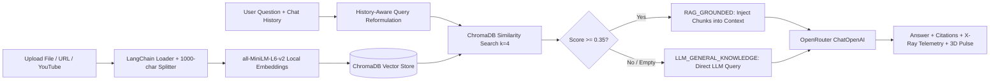

# AURA RAG — Multi-Format AI Knowledge Assistant & 3D Data Galaxy

An interactive, mobile-first **Retrieval-Augmented Generation (RAG)** web application powered by **FastAPI**, **LangChain**, **ChromaDB**, **OpenRouter**, and **React Three Fiber**. Upload documents or links, watch them orbit in a live 3D Data Galaxy, chat with tailored tones and voice input, and inspect every step of the LangChain pipeline in real time with the built-in **X-Ray Inspector**.

---

## Key Features

- **Multi-Format Knowledge Base:** Ingest `.pdf`, `.docx`, `.txt`, `.csv`, `.xlsx`/`.xls`, Web URLs, and YouTube video transcripts.
- **Hybrid RAG + Base LLM Routing:**
  - Automatically checks ChromaDB and filters matches using a **35% (`0.35`) cosine relevance threshold**.
  - **`RAG_GROUNDED`:** Injects relevant chunks into the prompt and cites sources.
  - **`LLM_GENERAL_KNOWLEDGE`:** When no files are uploaded or no chunks meet the threshold, skips context injection and answers directly using the LLM's pre-trained knowledge.
- **Interactive 3D Data Galaxy (`Three.js`):**
  - Color- and shape-coded 3D nodes orbit a central core for every uploaded source.
  - Cited sources pulse and emit energy beams toward the core; hovering a chunk in the X-Ray Inspector highlights its 3D node.
- **LangChain X-Ray Inspector (Collapsible Right Panel):**
  - **Live Pipeline Flow:** Visualizes *User Query → History-Aware Reformulation → Vector Search (`all-MiniLM-L6-v2`) → LLM Generation (OpenRouter)*.
  - **Retrieved Chunks:** Displays exact raw text snippets, page/sheet metadata, and cosine similarity percentages.
  - **Token & Cost Ledger:** Tracks input/output tokens (broken down into *System*, *Retrieved Chunks*, and *History + Question*) and estimated cost (`$0.00 FREE` for free models).
  - **Prompt Anatomy:** Shows the exact assembled prompt payload sent to OpenRouter.
- **Live OpenRouter Model & Key Manager:** Enter your OpenRouter API key in the UI (`localStorage`) and search/filter all live OpenRouter models (`All`, `Free Only`, `Paid`).
- **Tailored Tone, Voice Input & History:** Switch response styles (`Tailored`, `Concise`, `Detailed`, `Bullets`, `Technical`), dictate questions via browser microphone, and manage persistent multi-session chat history.
- **Mobile-First Responsive UI:** Full-height chat on mobile with a native **Chat | Sources | History | X-Ray** bottom navigation bar and side-by-side frosted-glass panels on desktop.

---

## How It Works



1. **Document Ingestion (`POST /upload-file`, `POST /upload-url`):**
   - Files and URLs are parsed using LangChain loaders (`PyPDFLoader`, `Docx2txtLoader`, `TextLoader`, `CSVLoader`, `pandas.read_excel`, `WebBaseLoader`, `YoutubeLoader`).
   - `RecursiveCharacterTextSplitter` splits text into `1000`-character chunks with `200`-character overlap, embeds them locally with `sentence-transformers/all-MiniLM-L6-v2`, and persists them to `backend/chroma_db/`.
2. **Query & Retrieval (`POST /chat`):**
   - If chat history exists, LangChain reformulates follow-up questions into a standalone search query.
   - ChromaDB runs `similarity_search_with_relevance_scores(..., k=4)` and keeps chunks with `similarity_score >= 0.35`.
   - OpenRouter generates the response in the selected `response_style` and returns `{ answer, sources, answer_mode, mode_reason, telemetry }`.

---

## Project Structure

```text
.
├── .gitignore
├── backend/
│   ├── main.py                # FastAPI app & REST endpoints
│   ├── rag_pipeline.py        # LangChain loaders, ChromaDB, Hybrid RAG & telemetry
│   └── requirements.txt       # Python dependencies
└── frontend/
    ├── index.html             # SEO meta, Open Graph, Twitter Card & JSON-LD
    ├── package.json
    ├── vite.config.js
    ├── public/
    │   ├── ai-head.jpg        # 3D rotating centerpiece artwork
    │   ├── robots.txt
    │   └── sitemap.xml
    └── src/
        ├── App.jsx
        ├── index.css
        ├── main.jsx
        └── components/
            ├── ChatPanel.jsx          # Chat UI, tone pills, mic input & X-Ray toggle
            ├── ContourHero.jsx        # Blended 3D-rotating copper head centerpiece
            ├── DataGalaxy3D.jsx       # Three.js / R3F interactive 3D source galaxy
            ├── KnowledgeSidebar.jsx   # File/URL uploader, sources list & chat history
            ├── RagInspectorDrawer.jsx # 4-tab LangChain X-Ray Inspector
            ├── SettingsModal.jsx      # OpenRouter API key & live model selector
            └── ToastContainer.jsx     # Status & error notifications
```

---

## Quick Start

### 1. Backend (FastAPI)

```powershell
cd backend
python -m venv .venv
.\.venv\Scripts\activate
pip install -r requirements.txt
```

Create `backend/.env` (or configure your API key directly in the UI):

```env
OPENROUTER_API_KEY=your_key_here
OPENROUTER_MODEL=openai/gpt-4o-mini
CHROMA_PERSIST_DIR=./chroma_db
```

Start the backend server on port `8000`:

```powershell
.\.venv\Scripts\python.exe -m uvicorn main:app --reload --port 8000
```

### 2. Frontend (React + Vite)

```powershell
cd frontend
npm install
npm run dev
```

Open **http://localhost:5173** in your browser.

---

## API Endpoints

| Method | Endpoint | Description |
| :--- | :--- | :--- |
| `GET` | `/` | Health check |
| `GET` | `/models` | Fetch live OpenRouter models (sorted free-first) |
| `POST` | `/upload-file` | Upload & index `.pdf`, `.docx`, `.txt`, `.csv`, `.xlsx`, `.xls` |
| `POST` | `/upload-url` | Fetch & index a Web URL or YouTube transcript |
| `POST` | `/chat` | Run Hybrid RAG + return answer, sources, mode & X-Ray telemetry |
| `DELETE` | `/reset` | Clear the ChromaDB vector store |

---

## Author & Contact

- **Built by:** Mudugal Sai Harsha Vardhan
- **Contact:** [mudugalharsha@gmail.com](mailto:mudugalharsha@gmail.com)

